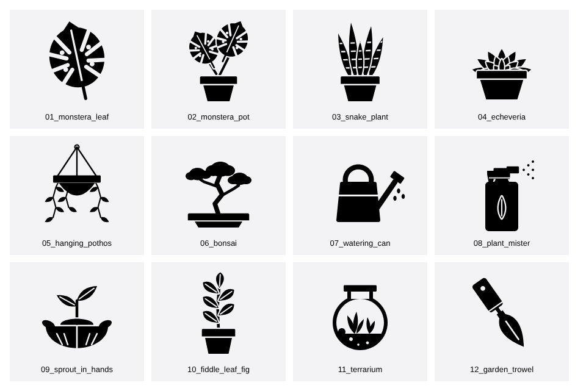

# Noun Project 아이콘 정리 (song8776)

프로필: https://thenounproject.com/creator/song8776/ (아이콘 152개, 세트 12개, 2026-11-01 기준)

## 1. 제목·태그 정리안: `1_titles_tags_sets.csv`
- 152개 아이콘마다 **현재 제목 → 제안 제목, 태그, 제안 세트, 메모**를 정리했어요.
- 현재는 서로 다른 제목이 92개뿐이에요(`flowerpot` 14개, `timber` 6개 등). 제안안은 **152개 모두 다른 제목**이에요.
- 그림과 제목이 안 맞는 것은 `note` 칸에 표시했어요.
  - #24 `fender` → 그림은 판다
  - #117 `Blender` → 스탠드 믹서
  - #124 `Dishwasher` → 세탁기
  - #115 오븐으로 보임, #52·#119는 직접 확인 필요
- 사이트에서 제목 칸이 짧은 단어만 받으면, 제안 제목은 첫 번째 태그로 쓰세요.

## 2. 세트 정리안 (같은 CSV의 `proposed_set` 칸)
지금 있는 12개 세트에 50개 남짓이 빠져 있어서 아래 19개 세트로 다시 묶었어요.

| 세트 | 개수 | | 세트 | 개수 |
|---|---|---|---|---|
| Plants & Flowers | 17 | | Home Appliances | 7 |
| Houseplants | 16 | | Food | 7 |
| Space & Tech | 13 | | Occupations | 7 |
| Transport | 11 | | Landmarks & Religion | 7 |
| Animals | 9 | | Gym & Fitness | 7 |
| Safety | 9 | | Lumber & Woodwork | 6 |
| Fruit | 8 | | Mental Wellness | 5 |
| Amusement Park | 7 | | Various | 5 |
| Beach & Summer | 4 | | Communication | 4 |
| Wedding | 3 | | | |

## 3. 새 아이콘 세트: "Houseplant Care" (`new_icons/`)
가장 강한 주제인 식물을 확장하는 12개예요. 실내 식물 키우기(플랜테리어)는 꾸준히 검색되는 주제예요.
기존 화분 아이콘과 같은 검은 실루엣 스타일로 맞췄어요.



- 형식: 100×100 SVG, 검은색 단색, 하나의 path, stroke·텍스트·마스크 없음 (`scripts/check_svg.py` 통과)
- 업로드용 제목·태그: `3_new_icons_metadata.csv`
- 업로드 전에 Illustrator나 Figma에서 한 번 열어 모양을 다듬는 걸 권해요.

## 스크립트
```bash
python3 scripts/make_icons.py new_icons        # 아이콘 다시 생성 (pip install shapely)
node scripts/preview.js new_icons preview.png  # 미리보기 시트 (playwright)
python3 scripts/check_svg.py new_icons         # 업로드 전 검사
```
